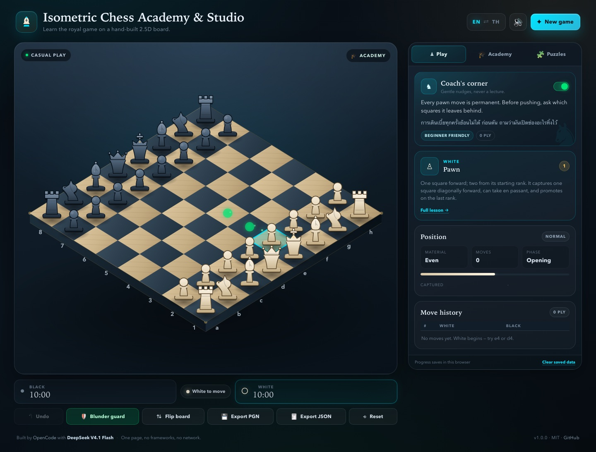

# Isometric Chess Academy &amp; Studio

A complete, offline, bilingual chess studio on a hand-built **2.5D isometric board**. Full international chess rules, a piece-by-piece academy, a blunder guard that explains mistakes, five beginner puzzle drills, synthesized sound, and local progress saving — all in one HTML page with **no frameworks, no build step and no network calls**.

**Version 1.0.0** · [Live demo](https://somphol.github.io/isometric-chess-academy/) · MIT

[](https://github.com/somphol/isometric-chess-academy/actions/workflows/ci.yml)
[](https://somphol.github.io/isometric-chess-academy/)
[](LICENSE)
[](https://github.com/somphol/isometric-chess-academy/releases/tag/v1.0.0)



> **This is standard Western chess.** It uses kings, queens, bishops, rooks, knights and pawns with castling, en passant, promotion, checkmate, stalemate and the usual draw rules. Thai is only an interface language — this is **not Makruk** (Thai chess).

> **Another AI agent or maintainer?** Start with [docs/REPRODUCTION.md](docs/REPRODUCTION.md), then [docs/PROVENANCE.md](docs/PROVENANCE.md) and [docs/DECISIONS.md](docs/DECISIONS.md). The checksum manifest is [docs/MANIFEST.sha256](docs/MANIFEST.sha256).

## Why it exists

Most beginner chess sites are either a bare board or a wall of theory. This studio puts a calm, tactile 2.5D board next to a patient coach. You can play a casual game, stop to inspect any piece, undo a blunder and read why it was dangerous, then practise the same idea in a five-minute puzzle.

## Features

### The board
- **True isometric projection** on HTML5 Canvas: every tile is a diamond, every piece is a vector sprite with a carved base, soft shadow and depth extrusion.
- **Click-to-square mapping** in both orientations, including a flipped board. Mouse, touch and keyboard all work.
- **Highlight language:** cyan selected tile, emerald move dots with travelling pulse dots, amber last move, blue hover, red check glow.
- **Responsive and HiDPI** with a cached static board layer so animation stays smooth.
- **Synthesized Web Audio:** move, capture, castle, check, promotion, undo, blunder, success and end-game cues. No audio files.

### The game
- Full international rules: pawn double-step, en passant, castling (both sides, all legality conditions), promotion (queen / rook / bishop / knight modal), check, checkmate, stalemate.
- Draw detection: insufficient material, fifty-move rule and threefold repetition.
- Turn management with a 10-minute clock per side, active-side glow and low-time warning.
- Move history in **Standard Algebraic Notation**, including disambiguation, `+`, `#`, `O-O`, `O-O-O` and `=Q`.
- Undo, board flip, new game, reset.

### The Academy
- **Piece inspector** for all six pieces: point value, movement rules, tactical role, a short history and a coach's tip. Opening it lights the piece's legal paths on the board.
- **Language-aware coach** (English or ภาษาไทย, following the toggle) that reacts to the position: centre control, development, king safety, material balance, checks and loose pieces.
- **Blunder guard** — after a move, the engine checks whether the piece is hanging, losing an exchange, or allowing mate in one. If it is, a pop-up explains the problem in the selected language and offers **Undo & learn**.
- **Compact peek card** in the Play tab so clicking a piece always brings up its explanation, even while playing.

### The puzzles
Five drills loaded from a local JSON block in `index.html`:

| # | Puzzle | Idea |
|---|--------|------|
| 01 | Back-rank mate | The eighth rank is a cage when the pawns never move |
| 02 | The ladder mate | Two rooks working one rank apart |
| 03 | Save the bishop | Capture the attacker, not the attacked |
| 04 | The royal fork | A check that also wins the queen |
| 05 | Bring the king home | Castling activates two pieces at once |

Each puzzle has a hint, a bilingual lesson, attempts tracking, a completion streak and a best streak. Progress is saved separately from the casual game.

### Language and persistence
- **EN ⇄ TH toggle** translates every control, tab, lesson, piece description, puzzle and dialog. Only the selected language is shown; switching also re-renders any open lesson.
- Auto-saves the ongoing game (move list, clocks, settings) and puzzle streaks to `localStorage` under `isometricChessAcademy.v1`.
- **Export PGN** (`isometric_chess_game.pgn`) and **Export JSON** (`isometric_chess_progress.json`) download the current game, history, clocks, settings and puzzle progress.

## Run locally

There is no install and no build.

```bash
git clone https://github.com/somphol/isometric-chess-academy.git
cd isometric-chess-academy
python3 -m http.server 8080
```

Open <http://localhost:8080>. Opening `index.html` directly also works; the app only uses local files and `localStorage`.

## Controls

| Action | Mouse / touch | Keyboard |
|--------|---------------|----------|
| Select a piece | Click it | Arrow keys + Enter |
| Move | Click a highlighted square | Arrow keys + Enter |
| Clear selection | Click an empty square / Esc | Esc |
| Flip board | ⇅ Flip board | — |
| Undo | ↶ Undo | — |
| Change language | EN ⇄ TH | — |

Clicking a piece always opens its inspector card. In the Play tab the compact card links to the full Academy lesson.

## Compatibility

| Surface | Status |
|---------|--------|
| Current Chrome | Verified during development and release |
| Current Safari / Firefox / Edge | Expected to work; manual verification pending |
| Desktop | 1440 × 1180 verified |
| Mobile | 390 × 844 verified, no horizontal overflow |
| Hosting | GitHub Pages, any static host, or `file://` |
| Build | None; no Node runtime required to use the app |

The board uses standard Canvas 2D, Pointer Events and Web Audio. A browser without JavaScript shows a short notice instead of the studio.

## Verify

```bash
node scripts/check.mjs
```

The check suite is dependency-free and covers:

- Source/file integrity; no external runtime assets or network calls.
- English ↔ Thai dictionary symmetry and every `data-i18n` / `t()` key.
- All five puzzle FENs, expected moves, mates and checks.
- Perft: start position depths 1–4 (`20 / 400 / 8902 / 197281`) and Kiwipete depths 1–2 (`48 / 2039`).
- En passant, castling (rook and king placement), promotion, mate SAN, attack detection and material balance.
- `state.json` shape, when present.

The 1.0.0 release was additionally exercised in headless Chrome: real pointer clicks, flipped-board clicks, promotion modal, checkmate modal, blunder modal, puzzle wrong-turn + hint + solve, EN/TH switching, export, localStorage reload and a 390 px mobile viewport with no horizontal overflow.

## Deploy

GitHub Pages serves the repository root on `main`. There is no build output and no Jekyll processing (`.nojekyll` is present).

```bash
git push origin main
```

See [docs/DEPLOYMENT.md](docs/DEPLOYMENT.md) for Pages setup, custom domains, cache behaviour and rollback.

## Contributing

Bug reports, Thai copy review, accessibility findings and verified puzzle proposals are welcome. Start with [CONTRIBUTING.md](CONTRIBUTING.md) and run the checks before opening a pull request.

```bash
node --check script.js
node scripts/check.mjs
```

## Documentation

| Document | What it covers |
|----------|----------------|
| [docs/README.md](docs/README.md) | Documentation index by audience, conventions and health checks |
| [docs/REPRODUCTION.md](docs/REPRODUCTION.md) | Complete build book: requirements, stage-by-stage rebuild recipe, engine/renderer/UI contracts, checksums and handoff checklist |
| [docs/PROVENANCE.md](docs/PROVENANCE.md) | Original brief, late clarifications, session record, credential handling, release history |
| [docs/DECISIONS.md](docs/DECISIONS.md) | ADR log: why Western chess, fixed 2.5D, no dependencies, language isolation, credential strategy and more |
| [docs/MANIFEST.sha256](docs/MANIFEST.sha256) | SHA-256 checksums for the three source files and release screenshots |
| [docs/ARCHITECTURE.md](docs/ARCHITECTURE.md) | Board model, engine pipeline, isometric projection, renderer, storage schema, extension recipes |
| [docs/DESIGN.md](docs/DESIGN.md) | Visual system, semantics, motion, coaching voice, Thai glossary, design review checklist |
| [docs/TESTING.md](docs/TESTING.md) | Automated checks, headless verification, manual regression matrix, known gaps |
| [docs/DEPLOYMENT.md](docs/DEPLOYMENT.md) | GitHub Pages, custom domain, rollback, cache behaviour, deployment checklist |
| [docs/ACCESSIBILITY.md](docs/ACCESSIBILITY.md) | Keyboard map, colour and focus, verified behaviour, honest gaps, next steps |
| [docs/RELEASE.md](docs/RELEASE.md) | SemVer policy, version locations, release/hotfix/rollback process, notes template |
| [docs/PRIVACY.md](docs/PRIVACY.md) | Local storage, exports, hosting logs, clearing data, children's privacy |
| [docs/PUZZLES.md](docs/PUZZLES.md) | Puzzle ladder, teaching notes, authoring schema and validation rules |
| [docs/FAQ.md](docs/FAQ.md) | Rules, castling, storage, sound, browsers, classroom use, troubleshooting |

## Community and project

| File | Purpose |
|------|---------|
| [CONTRIBUTING.md](CONTRIBUTING.md) | Setup, style, i18n and puzzle contribution rules, pull-request checklist |
| [CODE_OF_CONDUCT.md](CODE_OF_CONDUCT.md) | Contributor Covenant 2.1 and private enforcement contact |
| [SECURITY.md](SECURITY.md) | Supported versions, private disclosure, scope, safe harbor |
| [SUPPORT.md](SUPPORT.md) | Quick fixes, issue templates, what to include, response expectations |
| [ROADMAP.md](ROADMAP.md) | Shipped work, 1.1 candidates, non-goals |
| [CHANGELOG.md](CHANGELOG.md) | Release history in Keep a Changelog format |
| [CITATION.cff](CITATION.cff) | Citation metadata for teaching and research use |
| [THIRD_PARTY_NOTICES.md](THIRD_PARTY_NOTICES.md) | Runtime dependency, artwork, font and licence notices |

## Project layout

| Path | Purpose |
|------|---------|
| `index.html` | Markup, bilingual hooks and the five-puzzle JSON block |
| `style.css` | Studio theme, layout, modals, responsive rules, Thai typography |
| `script.js` | Chess engine + isometric renderer + academy/UI |
| `assets/` | README screenshots |
| `scripts/check.mjs` | Dependency-free verification suite |
| `state.json` | Historical build record: session time, model tokens, deployment |
| `AGENTS.md` | Handoff notes for the next agent |
| `docs/` | Architecture, design, testing, deployment, accessibility, release, privacy, puzzles, FAQ |
| `CHANGELOG.md` | Release history |
| `CONTRIBUTING.md` | Development and contribution guide |
| `SECURITY.md` | Private vulnerability reporting |
| `SUPPORT.md` | Troubleshooting and issue guidance |
| `ROADMAP.md` | Direction and non-goals |
| `CITATION.cff` | Citation metadata |
| `.github/` | CI, Dependabot, issue forms, PR template, code owners |
| `.editorconfig` | Editor defaults: UTF-8, LF, two-space indent |
| `THIRD_PARTY_NOTICES.md` | Dependency and attribution notices |

## Credits

Built with **[OpenCode](https://opencode.ai)** and **DeepSeek V4.1 Flash** (`opencode-go/deepseek-v4.1-flash`).

`state.json` records the wall-clock build time and token usage captured from the OpenCode session database, including cache reads. It is a historical record, not runtime state.

## License

[MIT](LICENSE) © 2026 Somphol Boonjing
